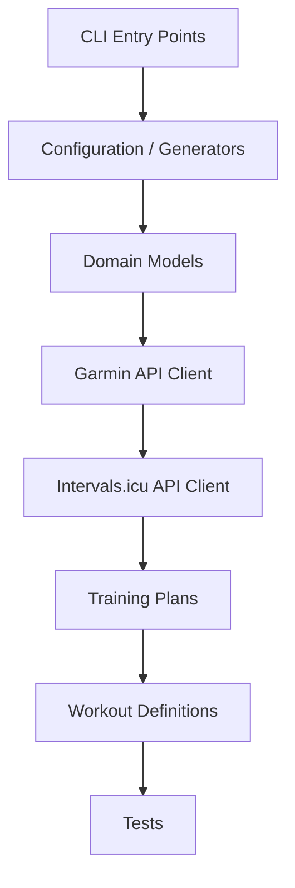

# Architecture Specification

> Generated by openlore v1.0.0 on 2026-07-20 07:41

## Purpose

This document describes the architectural patterns and structure of the system.

## Architecture Style

Pipeline architecture with a configuration-driven code generation layer. YAML configs are parsed
into domain models, transformed into API payloads, and dispatched to external REST APIs. A generator
subsystem auto-produces Python accessor functions for strength exercises, suggesting a
meta-programming/codegen pattern for the configuration layer.

## Requirements

### Requirement: LayeredArchitecture

The system SHALL maintain separation between:
- CLI Entry Points (Top-level command dispatch and argument parsing)
- Configuration / Generators (YAML loading, workout step generation, and strength exercise accessor codegen)
- Domain Models (Typed representations of workouts, steps, durations, targets, settings, and physiological parameters)
- Garmin API Client (Authenticated HTTP proxy to Garmin Connect REST endpoints (workouts, activities, calendar, biometrics, training plans))
- Intervals.icu API Client (Authenticated HTTP client for uploading workouts, events, folders, and athlete settings to Intervals.icu)
- Training Plans (YAML-defined multi-week training plan configurations covering cycling, running, triathlon, and strength)
- Workout Definitions (YAML-defined individual workout sessions across disciplines)
- Tests (Unit and integration tests for models, config generators, training plans, and API interactions)

#### Scenario: LayerSeparation
- **GIVEN** a request from the presentation layer
- **WHEN** business logic is needed
- **THEN** the presentation layer delegates to the business layer
- **AND** direct database access from presentation is prohibited

### Requirement: SecurityModel

The system SHALL implement security via: Session-based authentication via the _CompatClient compatibility layer, which wraps the garminconnect library or falls back to a local client. Tokens are persisted to disk (dump/load) and loaded from JSON strings (loads). MFA/two-factor login is supported via a two-step resume_login flow. Intervals.icu uses API key auth (inferred from IntervalsAPI.patch/put hub functions). No OAuth or JWT; credentials are stored as serialized token files.

#### Scenario: AuthenticatedAccess
- **GIVEN** an unauthenticated request
- **WHEN** accessing protected resources
- **THEN** access is denied

## System Diagram

## Layer Structure

### CLI Entry Points

**Purpose**: Top-level command dispatch and argument parsing
**Location**: `garminworkouts/__main__.py, intervalsicu/__main__.py`

### Configuration / Generators

**Purpose**: YAML loading, workout step generation, and strength exercise accessor codegen
**Location**: `garminworkouts/config/generators/base.py, garminworkouts/config/generators/strength/, garminworkouts/config/generators/cycling/, garminworkouts/config/generators/running/, garminworkouts/config/generators/swimming/, garminworkouts/config/includeloader.py`

### Domain Models

**Purpose**: Typed representations of workouts, steps, durations, targets, settings, and physiological parameters
**Location**: `garminworkouts/models/settings.py, garminworkouts/models/fields.py, garminworkouts/models/workoutstep.py`

### Garmin API Client

**Purpose**: Authenticated HTTP proxy to Garmin Connect REST endpoints (workouts, activities, calendar, biometrics, training plans)
**Location**: `garminworkouts/garmin/, account.py`

### Intervals.icu API Client

**Purpose**: Authenticated HTTP client for uploading workouts, events, folders, and athlete settings to Intervals.icu
**Location**: `intervalsicu/intervals/api.py, intervalsicu/intervals/client.py, intervalsicu/intervals/workout.py, intervalsicu/intervals/extraction.py, intervalsicu/intervals/threshold.py`

### Training Plans

**Purpose**: YAML-defined multi-week training plan configurations covering cycling, running, triathlon, and strength
**Location**: `trainingplans/`

### Workout Definitions

**Purpose**: YAML-defined individual workout sessions across disciplines
**Location**: `workouts/`

### Tests

**Purpose**: Unit and integration tests for models, config generators, training plans, and API interactions
**Location**: `tests/`

## Data Flow

CLI invocation → Settings resolves YAML plan/workout files and race date → includeloader parses YAML
with step generation (step_generator, rest_generator) → domain models (Workout, Duration, Power,
Pace) normalize targets and units → Garmin client serializes to Garmin API JSON and calls
workout-service/trainingplan-service/calendar-service endpoints; in parallel, Intervals.icu client
serializes to its format and calls /api/v1/athlete/* bulk upload endpoints. For type bootstrapping,
GarminTypes fetches workout/activity/golf type definitions from the Garmin API and writes them to
local config files.

## External Integrations

| System | Purpose |
|--------|---------|
| Garmin Connect (workout management, scheduling, biometric zones, calendar, activity download, training plans) | External integration |
| Intervals.icu (workout/event bulk upload, athlete sport settings, wellness data, activity streams) | External integration |
| garminconnect Python library (optional external auth dependency with internal fallback stub) | External integration |
| Race search API (running event discovery) | External integration |
